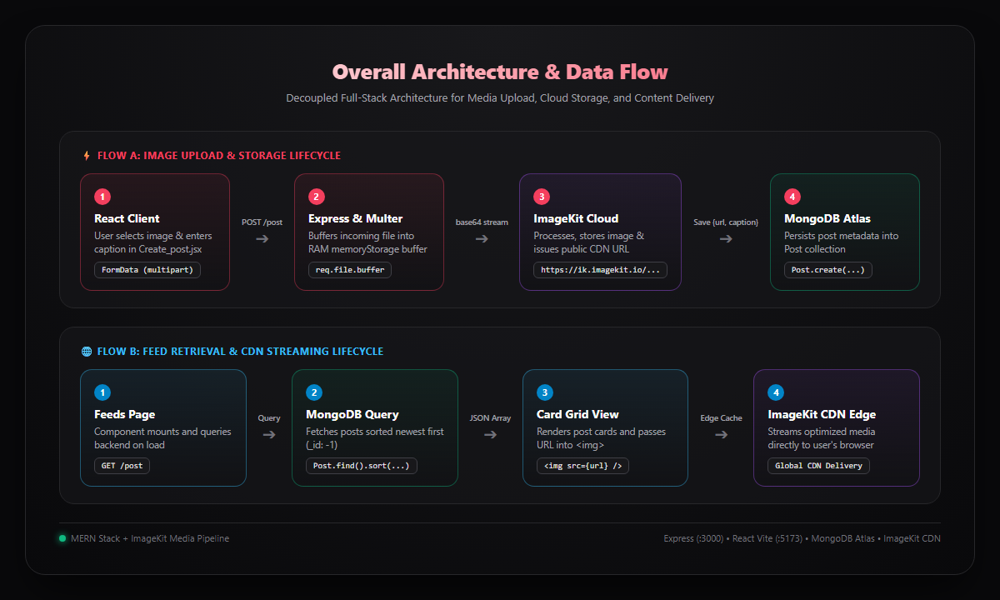

# ImageKit Posts App

[Live Deployment](https://imagekit-app-seven.vercel.app/)

A full-stack MERN application that uploads images to **ImageKit**, stores hosted image URLs and captions in **MongoDB Atlas**, and displays them on a responsive feeds page.

---

## Overall Flow of the Project

The application follows a decoupled client-server architecture where image binaries are uploaded through the backend to ImageKit's CDN, while only lightweight metadata (`url`, `caption`) is stored in MongoDB.

### Architecture & Data Flow Diagram



---

### Step-by-Step Execution Lifecycle

#### 1. Image Selection & Client Submission (`Create_post.jsx` → `postService.js`)
* The user chooses an image file using the standard file input (`accept="image/*"`) and enters an optional caption.
* On clicking **Submit**, `handleSubmit` prevents default form submission and bundles the file binary and caption string into a `FormData` object.
* `createPost()` in `postService.js` sends a `POST` request to `http://localhost:3000/post` with the `multipart/form-data` encoding.

#### 2. Multipart Processing & Memory Buffering (`App.js`)
* The Express server receives the HTTP request through CORS middleware.
* `multer({ storage: multer.memoryStorage() }).single('image')` intercepts the incoming stream.
* Instead of writing temporary files to the server's hard disk, Multer buffers the binary data directly into memory (`req.file.buffer`).

#### 3. Cloud Upload & CDN URL Generation (`imagekit.service.js`)
* The backend converts the memory buffer to a base64 string and calls the ImageKit SDK's `imagekit.upload()` method.
* ImageKit securely receives the file using the server-side `IMAGEKIT_PRIVATE_KEY` (keeping private credentials hidden from the client browser).
* ImageKit processes the image and returns a response containing the permanent CDN URL (e.g., `https://ik.imagekit.io/2arau5isi/...`).

#### 4. Database Persistence (`post.model.js`)
* Using the generated CDN URL and the caption from `req.body.caption`, Mongoose executes `Post.create({ url: result.url, caption })`.
* MongoDB Atlas stores the record inside the `posts` database with auto-generated timestamps and an `_id`.
* The server sends an HTTP `201 Created` JSON response back to the client.

#### 5. Feed Retrieval & Rendering (`Feeds.jsx` → `Card.jsx`)
* Upon successful upload, the frontend navigates the user to `/feeds`.
* On mount, `Feeds.jsx` triggers `getPosts()` to send a `GET` request to `http://localhost:3000/post`.
* The server queries `Post.find().sort({ _id: -1 })` to fetch all posts in reverse chronological order (newest first).
* The client receives the JSON array and renders a grid of `Card` components.
* The browser fetches and caches images directly from ImageKit's high-speed CDN edges via standard `` tags.

---

## Tech Stack

* **Frontend**: React 19, Vite, React Router, Tailwind CSS, Axios
* **Backend**: Node.js, Express, Multer (Memory Storage)
* **Cloud Storage**: ImageKit.io
* **Database**: MongoDB Atlas via Mongoose

---

## Project Structure

```text
posts/
├── assets/
│   └── project-flow.png              # Architecture & data flow diagram
├── Backend/
│   ├── src/
│   │   ├── db/
│   │   │   └── db.js                 # MongoDB connection setup
│   │   ├── model/
│   │   │   └── post.model.js         # Post schema (url, caption)
│   │   ├── services/
│   │   │   └── imagekit.service.js   # ImageKit SDK configuration
│   │   └── App.js                    # Express app, middleware & routes
│   ├── .env                          # Environment variables
│   ├── server.js                     # Entry point & DB connection bootstrapper
│   └── package.json
└── Frontend/
    ├── src/
    │   ├── components/
    │   │   └── Card.jsx              # Image card display component
    │   ├── pages/
    │   │   ├── Create_post.jsx       # Image upload & caption form
    │   │   └── Feeds.jsx             # Grid display of fetched posts
    │   ├── services/
    │   │   └── postService.js        # Axios API requests helper
    │   ├── App.jsx                   # Navigation bar and page routes
    │   ├── main.jsx                  # React DOM mount & BrowserRouter
    │   └── index.css                 # Global Tailwind CSS styles
    └── package.json
```

---

## Environment Variables

Create or update `Backend/.env` with your credentials:

```env
port_no=3000
dbkey=your_mongodb_connection_string

# ImageKit Credentials (from https://imagekit.io/dashboard/developer/api-keys)
IMAGEKIT_PUBLIC_KEY=your_imagekit_public_key
IMAGEKIT_PRIVATE_KEY=your_imagekit_private_key
IMAGEKIT_URL_ENDPOINT=https://ik.imagekit.io/your_id
```

---

## Getting Started

### 1. Backend Setup

```bash
cd Backend
npm install
npm run dev
```

The backend starts at `http://localhost:3000`.

### 2. Frontend Setup

In a new terminal:

```bash
cd Frontend
npm install
npm run dev
```

The frontend runs at `http://localhost:5173`.

---

## API Endpoints

| Method | Endpoint | Description | Payload |
|---|---|---|---|
| `POST` | `/post` | Upload image to ImageKit and save metadata to MongoDB | `multipart/form-data`: `image` (file binary), `caption` (text) |
| `GET` | `/post` | Fetch all posts sorted newest first | None |
